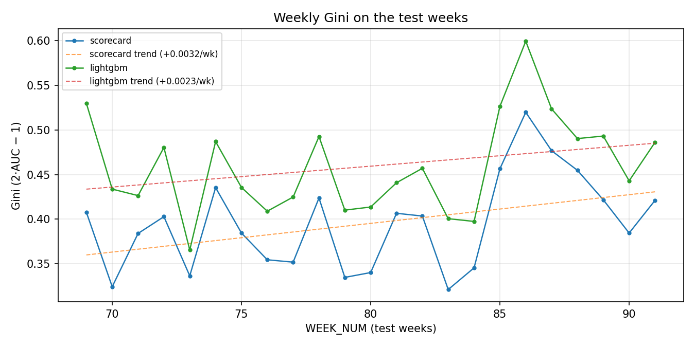
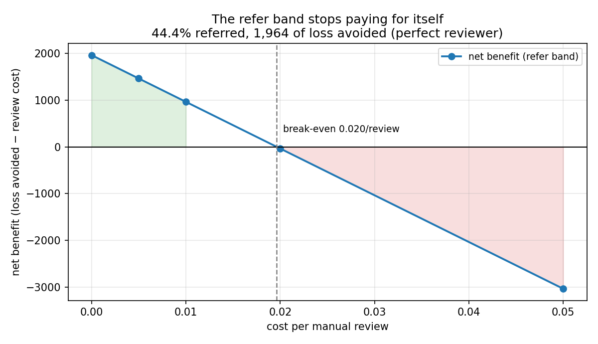
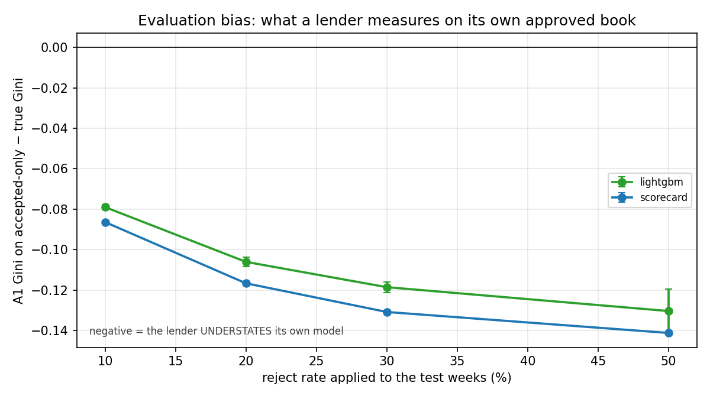
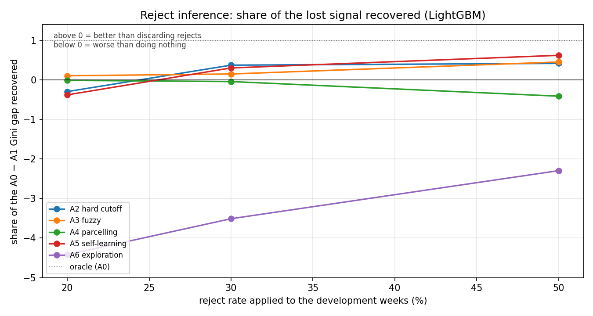

# Credit decision engine on Home Credit data

[](https://github.com/ilyas-elm/credit-decision-engine/actions/workflows/ci.yml)

A credit decision system, not just a classifier, built on the Kaggle *Home
Credit: Credit Risk Model Stability* data, and evaluated the way a credit risk
team evaluates models: out-of-time, on calibration, stability and profit.

> **Status:** all three questions have full-data numbers below, and
> [MODEL.md](MODEL.md) documents the model for review. Every pipeline stage
> has been run on the full competition data on Kaggle. The badge above is CI
> on a fresh clone: `uv sync --frozen`, lint, and 277 tests on synthetic
> fixtures.

## The three questions

1. What does a gradient-boosted challenger add over a classic scorecard once
   stability, calibration and profit are measured, not just AUC?
2. Where should the approval cutoff and the manual-review band sit, and what do
   they cost?
3. If the lender only observed outcomes for loans it approved, how wrong would
   its validation be, and which fix recovers the most per unit of cost: reject
   inference, or a small random-approval (exploration) budget?

## Headline numbers

Full data, 1,526,659 cases, evaluated out-of-time on the last 23 weeks
(`WEEK_NUM` 69-91), which nothing was fitted on. Kernel:
`ilyaselmaazouzi/hc-models`.

| | scorecard | LightGBM | better |
|---|---|---|---|
| Gini | 0.3944 | **0.4264** | challenger |
| mean weekly Gini | 0.3854 | **0.4205** | challenger |
| Gini slope / week | +0.0026 | +0.0019 | (both rising) |
| Gini residual sd | **0.0521** | 0.0592 | champion |
| **stability metric** | 0.3594 | **0.3909** | challenger |
| Brier | 0.02131 | **0.02117** | challenger |
| calibration-in-the-large, worst week | 0.0095 | **0.0084** | challenger |
| score PSI vs train | 0.5028 | **0.4202** | challenger |
| EMPCS | ≈0 | ≈0 | (see below) |

The champion is a **13-characteristic** scorecard with no sign flips: every
characteristic scores fewer points as its risk rises, so the table reads
correctly end to end.

## Question 1: what the challenger adds

About **3 Gini points** (0.394 → 0.426), and it keeps them once stability is
measured: the stability metric moves 0.359 → 0.391. The margin narrowed from 5
points after an income-encoding fix that helped the scorecard and left the
challenger unmoved (below). Neither model's Gini decays over the test weeks:
both slopes are positive, so the metric's 88× falling-slope penalty never
engages and the gap is driven by level, not trend. The challenger is also
*slightly* better calibrated and noticeably more stable in its score
distribution (PSI 0.42 vs 0.50). The one thing the champion wins is
week-to-week smoothness (residual sd 0.047 vs 0.051).

It is a real but unspectacular gain, bought with hundreds of trees against a
13-characteristic scorecard, under monotone constraints taken from the
champion's own binning so the challenger could not exploit relationships the
scorecard was forbidden.

**The profit comparison is degenerate, and that is the finding.** A loan is
profitable in expectation while `p(default) < roi / (roi + E[loss])`. At the
literature's assumptions that break-even is **49.0%**, against a book that
defaults at **3.1%**, so approving everyone is optimal, no cutoff binds, and
EMPCS is correctly ≈0 for both models. The original sensitivity grid never
crossed break-even either (lowest 34.8%). The grid now spans thin-margin,
high-loss-given-default credit (break-even 2.2%-49.0%) so it brackets the point
at which a cutoff starts to pay; the centre point is unchanged, because the
degeneracy there is a result about the assumptions rather than something to
tune away. Under this portfolio's economics, the model's value is not in
choosing an approval cutoff.

Score PSI above 0.25 for both models (0.50 and 0.42) is worth flagging: in
production that is an alert threshold, and it reflects genuine drift over 92
weeks rather than a modelling defect. Test-week PSI is reported here only; it
is never used for any selection decision.



Both curves rise over the test weeks, which is why the stability metric's 88×
falling-slope penalty never engages for either model. Also: [calibration by
bucket](docs/figures/calibration.png).

## Question 2: the cutoff and the review band

Kernel `ilyaselmaazouzi/hc-decision`. The conformal band is calibrated on the
val_b weeks, which nothing else in this project is fitted on. That is what
makes the coverage number meaningful rather than decorative.

### The refer band does not keep its promise, and that is the result

Mondrian (class-conditional) split conformal at α = 0.10, measured per class on
the test weeks:

| | coverage | target |
|---|---|---|
| non-default | 0.959 | 0.90 ✓ |
| **default** | **0.747** | 0.90 ✗, **below target in 23 of 23 weeks** |

Split conformal guarantees coverage *under exchangeability*, and these weeks
are not exchangeable with val_b: the default rate and the score distribution
both drift (score PSI 0.54). So the guarantee fails, in the same direction and
in every single week. This is exactly why the brief says to measure coverage
rather than assume it.

It is still worth doing. A marginal threshold on the same data covers the
default class **0.000** of the time; it is the majority class's threshold
wearing a guarantee. Mondrian takes that from 0 % to 75 %. Short of its
promise, and vastly better than the alternative.

### Where the cutoff sits

Swept across all 21 assumption points: the profit-maximising acceptance rate
runs from **71.5 % to 100 %**, and **only 8 of 21 points bind at all**. At the
literature's assumptions the answer remains "approve everyone". The layer is
exercised at the tightest binding corner (roi 0.02, LGD-heavy), giving 71.5 %
acceptance:

| band | share | bad rate |
|---|---|---|
| approve | 51.3 % | 0.011 |
| refer | 44.4 % | 0.029 |
| decline | 4.3 % | 0.078 |

The bands separate risk monotonically, which is the minimum one should demand.
A 44 % referral rate is far beyond any real review desk, and that is a direct
consequence of α = 0.10 on a 3 % default book.

**The review band stops paying for itself at about 0.02 per review**
([figure](docs/figures/referral_economics.png)): against 1,964 units of loss
avoided (assuming a *perfect* reviewer, an upper bound, not an estimate),
100,034 reviews cost 1,000 at 0.01 and 2,001 at 0.02, which turns net benefit
from +964 to -37.



Also: [the strategy curve](docs/figures/strategy_curve.png), approval rate
against bad rate and profit.

### Reasons and recourse

Principal reasons are the true drivers, led by `delq_dpd_mean`,
`afford_annuity_to_taxincome` and `prev_share_rejected`. Recourse only ever
touches the config's actionable list, current application and recent shopping
behaviour, so past delinquency appears in the explanation and never in the
advice.

How far recourse is from clearing the cutoff, in scorecard points:

| population | n | short by | actionable headroom | reachable |
|---|---|---|---|---|
| decline band | 9,701 | 43.4 | 22.2 | **3.9 %** |
| refer band | 54,553 | 11.1 | 19.6 | **77.6 %** |
| all below cutoff | 64,254 | 16.0 | 20.0 | **66.4 %** |

Outright declines sit about 3.9 times further from the cutoff than anything an
applicant can change: for them recourse is genuinely infeasible, and saying so
is more honest than inventing advice. The referred population is a different
question, **78 % of them could reach the cutoff** by borrowing less or waiting
out recent credit searches.

### Fairness audit (audit only, no mitigation)

| sex | n | approval rate | observed default | mean PD |
|---|---|---|---|---|
| F | 145,315 | 0.485 | 0.0176 | 0.0278 |
| M | 80,199 | 0.564 | 0.0299 | 0.0247 |

Women are approved less often (48.5 % vs 56.4 %) while defaulting less often
(1.76 % vs 2.99 %), and the model over-predicts their risk while
under-predicting men's. The disparity is not a threshold artefact; it is
miscalibration by group, in the direction that penalises the lower-risk group.
Reported, not mitigated, as the brief requires.

| age band | n | approval rate | observed default | mean PD |
|---|---|---|---|---|
| 20s | 27,384 | 0.606 | 0.0449 | 0.0244 |
| 30s | 48,676 | 0.636 | 0.0273 | 0.0229 |
| 40s | 45,188 | 0.673 | 0.0216 | 0.0200 |
| 50s | 35,221 | 0.632 | 0.0158 | 0.0217 |
| **60s** | 54,407 | **0.254** | **0.0123** | **0.0370** |
| **70+** | 14,638 | **0.118** | **0.0131** | **0.0380** |

Applicants in their 60s are approved at **25.4 %** and those 70+ at **11.8 %**,
against 61-67 % for everyone younger, while being the safest groups in the
book, defaulting at 1.2-1.3 % against 4.5 % for applicants in their 20s. The
model predicts them as the riskiest: a mean PD of 3.7-3.8 % for a group that
defaults at 1.2 %, roughly a threefold over-prediction, while under-predicting
the youngest by about half.

This is larger and more consequential than the disparity by sex, and it is the
same failure in a sharper form: the model is miscalibrated by group and the
cutoff then converts that into an approval gap. Age is in the *excluded* list
for recourse, so a declined older applicant is told the truth about why and
offered nothing to do about it, which is honest, and also the point at which an
audit stops being an academic exercise.

Verified before reporting: `birth_259D` gives ages 23-73 (1st-99th percentile,
median 44) and agrees with the independent `dateofbirth_337D` on 99.96 % of
overlapping cases.

#### Why, the model has no age feature

Age is not an input, so the disparity is built out of a proxy. The attribution
below is computed by the decision stage and recorded in
[`decision_summary.json`](docs/decision_summary.json) under
`fairness.age_mechanism`, so it can be checked rather than taken on trust.

The 60+ cohort gives up **19.6 scorecard points** net against everyone else.
The characteristics that cost them points account for 24.5, so the rest hand a
little back, and **21.1 of the loss comes from the two income-derived
characteristics**:

| characteristic | points, 60+ | points, under 60 | gap |
|---|---|---|---|
| `afford_annuity_to_taxincome` | 45.7 | 60.2 | **-14.5** |
| `afford_taxincome_total` | 45.4 | 52.0 | **-6.6** |
| `delq_n_payment_months` | 46.2 | 49.5 | -3.3 |

Income is derived from the tax registry, which records employment payments, and
retirees do not appear in it: **96.3 %** of the over-60s have no income record
against **8.2 %** of everyone younger, which makes the absence a **93.2
%-accurate test for being over 60**. It does not fade in gradually, it steps:

| age band | n | share with no tax-registry income |
|---|---|---|
| 20s | 27,384 | 4.4 % |
| 30s | 48,676 | 5.4 % |
| 40s | 45,188 | 6.4 % |
| 50s | 35,221 | 17.4 % |
| 60s | 54,407 | **95.3 %** |
| 70s | 14,638 | **100.0 %** |


The obvious conclusion would be that the scorecard treats a missing income
record as risky. It does not. That is the Missing bin on both characteristics:

| characteristic | bin | n (train) | event rate | WoE | points |
|---|---|---|---|---|---|
| `afford_annuity_to_taxincome` | Missing | 390,648 | 3.05 % | +0.0253 | 45.1 |
| `afford_taxincome_total` | Missing | 390,645 | 3.05 % | +0.0253 | 45.1 |

The bin sits at the neutral middle, which is what its event rate warrants. The
absence carries no extra risk on the train weeks the bins were fitted on (3.050
% against 3.165 % for everyone else) and *less* risk on the test weeks, within
both groups: 1.24 % against 1.34 % among the over-60s, 2.25 % against 2.65 %
among the under-60s. Nowhere in the data is a missing income record a sign of
higher default.

What produces the gap is drift. `afford_annuity_to_taxincome` runs from 31.4
points at worst to 65.4 at best, and the Missing bin's 45.1 was fixed when the
scorecard was fitted (`scripts/drift_recon.py` recomputes this table and the
one below it from a pulled features parquet):

| | median ratio | mean points, non-missing |
|---|---|---|
| train weeks | 0.267 | 46.4 |
| test weeks | 0.034 | **61.7** |

On the train weeks the population with an income record averaged 46.4 points,
within a point and a half of the Missing bin. By the test weeks their median
annuity-to-income ratio had fallen from 0.267 to 0.034, 86.6 % of them sat in
the two best bins, and they averaged 61.7. `afford_taxincome_total` moved the
same way, median income 11,933 to 107,563 and mean points 45.6 to 52.6. The
Missing bin cannot follow, because its points are frozen at fit time. **The
over-60s were not marked down; everyone else moved up and left them behind.**
This is the same drift as the score PSI of 0.50 reported above, surfacing as a
group disparity.

That changes what the fix is. A fairness constraint at the threshold would
address none of it, and neither would reweighting: the scorecard's treatment of
the absent record is already neutral and already matches its risk. Two things
would work, and both are changes to the pipeline rather than the cutoff. Give
retirees an income source the registry does not carry, pensions and benefits,
so that they are not in the Missing bin at all and the proxy dissolves. And
refit, or at least monitor the distance between a Missing bin's fixed points
and the live population's mean points on the same characteristic, because a
static Missing bin silently becomes a relative penalty as soon as the scored
population moves. Neither is implemented here. This is an audit, as scoped, and
the finding is the deliverable.

## Question 3: sampling bias

Kernel `ilyaselmaazouzi/hc-sampling-bias`: 160 fits, 17.6 min
([`sampling_bias_summary.json`](docs/sampling_bias_summary.json)). Policy weeks
0-22, development 23-63 (labels hidden for the rejected), test 64-91 with every
label. 150k development cases per arm, identical features and fixed
hyperparameters throughout, three seeds on the stochastic arms. The config asks
for the top 40 features by IV and gain, but the build produces 36, so every arm
simply uses all of them and that selection step never binds.

**Limitation, which bounds every number here:** the Home Credit data already
contains booked loans only. The real rejects are gone. This simulates a
*second* selection policy on top of an already-selected population.

### How wrong is the lender's own validation?

Measured on the test weeks its policy would have approved, against the truth
over everyone:

| reject rate | 10 % | 20 % | 30 % | 50 % |
|---|---|---|---|---|
| LightGBM | -0.076 | -0.082 | -0.069 | -0.051 |
| scorecard | -0.094 | -0.127 | -0.136 | -0.157 |

A lender measuring on its own approved book **understates its Gini by 5 to 16
points**, range restriction, not a modelling fault. The scorecard is hurt
roughly twice as badly as the challenger, and its bias grows steadily with the
reject rate while the challenger's does not.

### Which fix recovers the most?

Share of the A0 - A1 gap recovered, LightGBM, where that gap is at least 0.01
Gini (it is, at every reject rate):

| arm | r=10 % | r=20 % | r=30 % | r=50 % |
|---|---|---|---|---|
| A2 hard cutoff | 0.06 | 0.67 | **0.97** | **0.88** |
| A3 fuzzy | 0.28 | 0.29 | 0.18 | 0.65 |
| A4 parcelling | 1.05 | -0.20 | -0.18 | 0.16 |
| A5 self-learning | -1.08 | -0.23 | 0.60 | 0.89 |
| A6 exploration | -2.61 | -5.63 | -3.90 | -1.06 |

Four things come out of this:

1. **The crudest method wins.** A2 simply labels every reject bad, no model, no
   weighting, no uncertainty, and it recovers 97 % of the lost signal at a 30 %
   reject rate. The more elaborate arms do not beat it. When a policy rejects
   the worst 30 % by score, "these were bad" turns out to be close enough to
   true to be worth asserting.
2. **Severity matters more than method.** At a 10 % reject rate almost nothing
   helps and the gap is only 0.011 Gini to begin with. By 50 % the gap is 0.135
   and three arms recover most of it.
3. **The exploration budget fails everywhere, on variance rather than price.**
   Priced as profit at a fixed binding acceptance against realised loss on the
   loans bought to learn from, net is negative at every budget and reject rate,
   with the damage running **2-53× the cost** (at r=30 %, p=1 %: cost 7.2,
   profit -382). The 100/p inverse-propensity weight gives a few hundred cases
   the same total weight as tens of thousands. The largest budget is the least
   bad at every reject rate (p=5 % runs 1.5-4.9x against 2.6-53x at p=1 %),
   which is the variance signature, though it is not monotone in p: at the 10 %
   and 20 % reject rates p=2 % is worse than p=1 %.
4. **The scorecard mostly has no gap to recover.** At 10 % and 20 % reject rates
   its accepts-only model is *better* than its own oracle (0.438 against 0.411),
   so recovery is undefined and reported as such. Binned logistic regression is
   markedly more robust to this selection than the GBM.

**Against the literature.** Kozodoi, Lessmann, Alamgir, Moreira-Matias and
Papakonstantinou, *Fighting Sampling Bias: A Framework for Training and
Evaluating Credit Scoring Models*
([arXiv:2407.13009](https://arxiv.org/abs/2407.13009), 2024; *European Journal
of Operational Research* 324(2), 2025). They conclude that "reject inference is
a difficult problem with modest potential to improve scorecard performance",
and that addressing sampling bias during evaluation is "a much more promising
route to improve scoring practices".

Their §7.1.2 gives a sharper, testable claim: BASL improves scorecards **at
acceptance rates below 20 %**, with gains rising as acceptance falls (§8), and
largest at a bad rate of **2-5 % among accepts**. The right arm to test that
against is A5, which is loosely BASL-inspired, not A2, which is one of *their*
benchmarks.

**The direction reproduces cleanly.** A5's recovery is strictly monotone in
acceptance rate:

| acceptance | 90 % | 80 % | 70 % | 50 % |
|---|---|---|---|---|
| A5 recovery | -1.08 | -0.23 | **+0.60** | **+0.89** |

That is their relationship, found independently on different data: the less a
policy accepts, the more reject inference is worth.

**The threshold does not.** They report BASL needing acceptance below 20 %; A5
turns positive here between 80 % and 70 %, and this experiment never goes below
50 % acceptance at all. Two things plausibly explain the gap, and they pull in
opposite directions:

- This book defaults at **3.14 %**, inside the 2-5 % band they identify as
  producing the largest gains, so the imbalance condition here is *favourable*.
- But the selection is simulated on an already-booked population. The hidden
  labels still belong to applicants the original lender approved, so the
  "rejects" are far less extreme than true rejects would be. That makes this the
  easier problem, and the recoveries here an upper bound rather than a
  contradiction of their result.

The evaluation finding, by contrast, agrees without qualification: bias of
0.05-0.16 Gini, present at every reject rate, in the same direction throughout,
larger and far more consistent than anything the inference arms deliver.





## How to reproduce

```bash
uv sync
uv run pytest
```

Tests and CI run entirely on generated fixtures (`tests/fixtures.py`) that
match the competition schema. Competition data is never committed, so a fresh
clone needs no Kaggle credentials to go green.

Full-data results come from Kaggle CPU kernels, pushed from this repo by
`scripts/kaggle_run.py <stage>`, which bundles `src/` and `config/` into the
kernel so the run uses committed code and nothing else. The chain is
`make-sample` and `env-probe`, then `features`, then `models` and
`sampling-bias`, then `decision`; the later stages read the feature build
through `kernel_sources`, so it runs once. Each generated bundle carries the
short commit it was built from in its header, which is what ties a result back
to a revision. The kernels themselves are private, as the brief requires, so
there is no public kernel URL to link: reproduction goes through the code here,
not through my Kaggle account. Run them under your own account by setting
`KAGGLE_USERNAME`, or `[kaggle] username` in the config.

Reproducing the chain needs competition access, but reading the results does
not. Every number quoted above is committed:

| Artefact | What is in it |
|---|---|
| [`comparison.csv`](docs/comparison.csv) | the headline table, champion vs challenger |
| [`feature_report.csv`](docs/feature_report.csv) | per feature: missing %, IV, PSI, univariate Gini, kept or dropped, and why |
| [`scorecard_table.csv`](docs/scorecard_table.csv) | the scorecard: characteristic, bin, WoE, points |
| [`decision_summary.json`](docs/decision_summary.json) | cutoff, band shares, conformal thresholds, recourse reach, sign-flip check, fairness audit |
| [`conformal_coverage_by_week.csv`](docs/conformal_coverage_by_week.csv) | realised coverage per class per test week |
| [`cutoff_sensitivity.csv`](docs/cutoff_sensitivity.csv) | the cutoff across the profit-assumption grid |
| [`referral_economics.csv`](docs/referral_economics.csv) | share referred against loss avoided, by review cost |
| [`decide_examples.json`](docs/decide_examples.json) | `decide()` output on real applicants, no identifiers |
| [`sampling_bias_arms.csv`](docs/sampling_bias_arms.csv) | every arm, reject rate, seed and model |
| [`sampling_bias_exploration.csv`](docs/sampling_bias_exploration.csv) | exploration cost against profit gain, per p |

Memory, measured rather than assumed: the features stage on the 3% local sample
peaks at 0.83 GB resident (`getrusage` and `/usr/bin/time -l` agree to within 1
MB), against the brief's ~4 GB budget for an 8 GB machine. The build is polars
lazy with `collect(engine="streaming")` and the features land as Float32.

## What is built

| Area | Module | State |
|---|---|---|
| Config (all thresholds and parameters) | `src/config.py`, `config/default.toml` | done |
| Out-of-time splits by `WEEK_NUM` | `src/splits.py` | done |
| Gini, weekly Gini, stability metric, PSI, calibration | `src/metrics.py` | done |
| EMPCS profit + strategy curve | `src/profit.py` | done |
| Champion scorecard (binning, selection, pdo_odds scaling) | `src/scorecard.py` | **done, run on full data** |
| Mondrian conformal refer band | `src/conformal.py` | done |
| Decision layer: cutoff, bands, reasons, recourse | `src/decision.py` | **done, run on full data** |
| Isotonic calibration (shared) | `src/calibrate.py` | done |
| Challenger: LightGBM with monotone constraints | `src/challenger.py` | **done, run on full data** |
| Shared evaluation + the three figures | `src/evaluation.py` | **done, run on full data** |
| Synthetic fixtures matching the schema | `tests/fixtures.py` | done |
| Kaggle push/poll/pull orchestration | `scripts/kaggle_run.py` | **done, exercised against the live API** |
| `make-sample` + reconnaissance kernel | `kaggle/make-sample/` | **done, run on full data** |
| Environment probe kernel | `kaggle/env-probe/` | **done, run** |
| Data reconnaissance | [`docs/DATA_NOTES.md`](docs/DATA_NOTES.md) | **done, on full data** |
| Feature build (polars, 6 families) | `src/features.py` | **done, run on full data** |
| Feature screening + report | [`docs/feature_report.csv`](docs/feature_report.csv) | **done, full data** |
| Sampling-bias experiment (arms A0-A6) | `src/sampling_bias.py` | **done, run on full data** |

277 tests, all on generated fixtures. All six kernels have been run end to end
on the real competition data.

## Environment

Pinned to the Kaggle image, not to the newest releases: Python 3.13.15, polars
1.35.2, pandas 2.3.3, numpy 2.1.3, scikit-learn 1.6.1, LightGBM 4.6.0.
Full-data results come from Kaggle kernels, so local tests are only evidence
about those runs if the stack matches. The versions were measured by
`kaggle/env-probe/`, not assumed, see
[docs/DATA_NOTES.md](docs/DATA_NOTES.md#kaggle-environment-as-measured).

## Things worth knowing, found the hard way

**EMPCS label encoding.** The underlying formula (Verbraken et al., 2014) is
written with the default class as 0, but the pinned `empulse` (0.13.0) performs
that inversion internally and expects `default = 1`, the same encoding as the
Home Credit `target` column. `target` is therefore passed through untouched.
Inverting it makes the metric blind (an informative model and pure noise both
score ≈0.2557) while returning a number ~50× larger, so the error flatters
itself. `tests/test_profit.py` pins this down and will fail if a future
`empulse` flips the convention back.

**Stability metric.** `mean(gini) + 88·min(0, slope) - 0.5·std(residuals)`,
computed on the weekly Gini curve as the model produces it. Scores are never
post-processed per week to improve it.

**`empcs` returns a rejection rate, not an acceptance rate.** The brief
describes `empcs` as returning "the profit-maximizing acceptance fraction".
`empcs_score.optimal_rate` actually returns the predicted-*positive* rate, and
since the positive class here is default, that is the fraction **rejected**.
Across nine bad-rate and loss-assumption combinations the raw value *rises*
with the bad rate (0.028 at a 5% bad book to 0.174 at 30%), the signature of a
rejection rate, while `1 - rate` tracks the strategy curve's acceptance optimum
throughout. Taken at face value it would have meant accepting 2.8% of a
low-risk portfolio. The cutoff is set from the strategy curve; EMPCS's implied
optimum is reported beside it, with the gap surfaced rather than reconciled,
since the two optimise different objectives.

**The IV screen is blind to a perfect leak.** optbinning collapses a perfectly
separating column into a single bin and reports **IV 0.0**, so the IV rule
reads a total leak as useless noise and drops it. The univariate-Gini screen is
what catches that case, which is why the brief specifies the two separately,
and the review annotation now survives an IV-based drop rather than being
overwritten by it.

**Never clip a denominator to avoid dividing by zero.** It trades an error for
something worse: a finite number of enormous magnitude that looks like data. On
the real sample, clipping the credit-limit denominator at 1e-9 produced a
utilisation feature topping **1.1 × 10¹³**, because 91% of cases report a zero
limit. It would have passed every screen. `safe_ratio` returns null instead,
and the binning process has a Missing bin for exactly that.

**A missing value is not a zero, and the difference was worth 0.02 Gini.**
`afford_taxincome_total` summed a case's tax-registry records. A case absent
from every registry summed to zero, so "no employment record" was written down
as "earns nothing" and landed in the lowest income bin beside genuinely
low-paid applicants, 34 % of the book in one bin. The fix was to distinguish
the two: sum the records when any exists, and return null when none does.

```python
present = pl.any_horizontal([pl.col(c).is_not_null() for c in inc_cols])
pl.when(present).then(pl.sum_horizontal([pl.col(c).fill_null(0.0) for c in inc_cols]))
  .otherwise(None)
```

It lifted the champion from Gini 0.376 to 0.396 and stability 0.340 to 0.360,
left the challenger unmoved, because a GBM splits on the missingness either
way, and raised approval for the over-70s from 8.6 % to 11.8 %. The same
conflation is the reason the group disparity above is a drift artefact rather
than a risk judgement: once the absence is null it gets its own bin, and that
bin is where the drift bites.

**The IV floor is sample-size dependent.** IV is computed on the bins it chose,
so it is biased upward and the bias shrinks with n. Over three pure-noise
columns at an 8% event rate, max IV runs 0.0889 at n=2,000, 0.0117 at n=10,000
and 0.0006 at n=200,000. The configured floor of 0.02 therefore screens noise
against the full train set but not on the 3% local sample, so feature selection
is a full-data decision, and the local sample exists to make the code run, not
to decide which features live.

**Why the refer band is class-conditional.** On synthetic exchangeable data at
a 3% default rate and a 90% coverage target, averaged over 300 calibration
draws:

| | non-default coverage | **default coverage** |
|---|---|---|
| marginal (one shared threshold) | 0.964 | **0.014** |
| Mondrian (per-class) | 0.900 | **0.899** |

A single shared threshold covers defaulters **1.4% of the time** while its
headline number looks healthy, under 3% defaults the pooled quantile is set
almost entirely by non-defaulters. Mondrian lands on target for both classes.
This is measured on exchangeable data, which is the favourable case; the real
data drifts, so coverage is reported per class *per test week* rather than
assumed.

## Model documentation

[MODEL.md](MODEL.md), purpose, data, design choices, out-of-time performance,
calibration and stability, limitations, and a monitoring plan with thresholds
set from the variation actually observed rather than from convention.

## References

- Kozodoi, N., Lessmann, S., Alamgir, M., Moreira-Matias, L., & Papakonstantinou, K.
  (2024). *Fighting Sampling Bias: A Framework for Training and Evaluating Credit
  Scoring Models.* [arXiv:2407.13009](https://arxiv.org/abs/2407.13009);
  *European Journal of Operational Research* 324(2), 616-628 (2025).
  Source of the reject-inference comparison. §7.1.2 supplies the acceptance-rate
  boundary condition tested above; §8 the direction of the effect. Arm A5 is
  loosely inspired by their BASL method, **A5 is not a reimplementation of
  BASL** and should not be read as one.
- Verbraken, T., Bravo, C., Weber, R., & Baesens, B. (2014). *Development and
  application of consumer credit scoring models using profit-based
  classification measures.* *European Journal of Operational Research* 238(2),
  505-513. [doi:10.1016/j.ejor.2014.04.001](https://doi.org/10.1016/j.ejor.2014.04.001).
  Defines the EMP measure for credit scoring that `empulse.metrics.empcs_score`
  implements, including the two-point-mass loss distribution and constant ROI
  that `[profit]` in config parameterises.

## Stack

Python 3.11, polars (lazy/streaming) for the feature build, pandas only at the
model boundary, scikit-learn, LightGBM, optbinning, empulse, matplotlib,
pytest.
